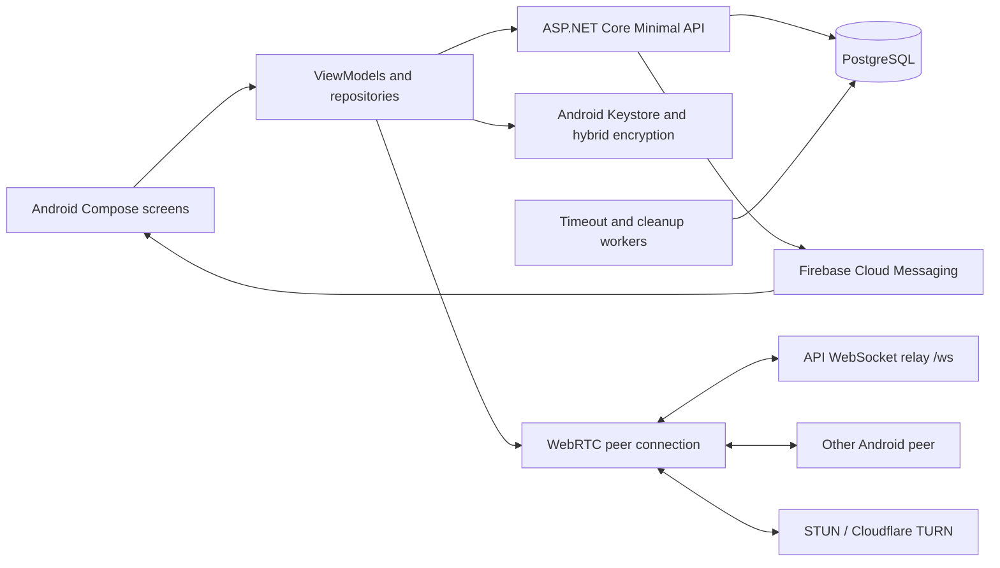

# Minit project reference

Reviewed: 2026-10-13. Scope: MinitApi and sibling MinitAppAndroid source, configuration structure, migrations, existing documentation, and API integration tests. This is a source-based snapshot, not verification of the deployed service. No production data or credentials were needed. Secret values are deliberately omitted.

## Purpose and business context

Minit is an Android communication application with display-name registration, shareable user codes, contacts, one-to-one WebRTC audio/video calls, encrypted text messages, invitations, usage tracking, and automatic deletion settings. Registration requires no phone number or email. Users receive a GUID identity and a unique eight-character public code.

The default monthly allowance is 6,000 call seconds (100 minutes). Administrators can change limits and adjust usage with a reason. This suggests a controlled communication-cost model; paid subscriptions, payments, revenue model, target audience, commercial commitments, and formal privacy policy are not established by the inspected source. Do not invent them as requirements.

Existing prose describes a voice-call app, but Android includes video tracks, camera capture, and a video toggle. Treat audio/video capability as implemented code, while product positioning still needs confirmation.

## Reference authority and repository map

Use executable source and DTOs before older prose when they conflict. Existing API `CLAUDE.md` and extensionless `Readme`, plus Android `SETUP.md` and `SIGNALING_SERVER.md`, are useful orientation but have stale claims listed below. No AGENTS.md was found in the inspected repository inventories or checked parent directories.

| Repository | Responsibility | Primary sources |
| --- | --- | --- |
| `MinitApi` | REST, PostgreSQL persistence, quotas, push notifications, WebSocket signaling, retention | `Program.cs`, `Endpoints/`, `Services/`, `Data/AppDbContext.cs`, `Domain/`, `Dtos/` |
| `../MinitAppAndroid` | Android UI, device identity/preferences, encryption, notifications, WebRTC media | `app/src/main/java/com/reza/minit/`, `app/build.gradle.kts`, `gradle/libs.versions.toml`, `AndroidManifest.xml` |

API naming is historical: solution `workspace.sln`, project `workspace.csproj`, namespace `Workspace.*`, tests `Workspace.Api.Tests`. Android namespace/application ID is `com.reza.minit`.

## Requirements recovered from implementation

These describe implemented intent and constraints; runtime defects can prevent execution.

| Area | Requirement / behavior | Evidence |
| --- | --- | --- |
| Identity | Register by display name, look up active users by public code; store local GUID/code/name/limit | `Endpoints/UserEndpoints.cs`, Android `data/local/UserPreferences.kt` |
| Contacts | Add/list directed contacts by code; unique owner/contact pair; invite redemption creates mutual contacts | `ContactEndpoints.cs`, `Services/InviteService.cs`, `AppDbContext.cs` |
| Invitations | Create, redeem, revoke, list active; default ten-character code, ten-minute TTL, one redemption; TTL 1–1440 minutes and max redemptions 1–100 | `InviteEndpoints.cs`, `InviteService.cs` |
| Calls | Active users can start/join/end calls; creator must have positive remaining quota at start; only creator is billed | `CallEndpoints.cs`, `QuotaService.cs` |
| Usage | Per-user UTC calendar-month accounting as integer YYYYMM; default 6,000 seconds; administrator limit changes and reasoned adjustments | `UsageEndpoints.cs`, `AdminEndpoints.cs`, `Domain/UsageAdjustment.cs` |
| Messaging | Store/relay ciphertext, per-party wrapped keys, IV and metadata; retrieve paged conversation and recent conversations | `MessageEndpoints.cs`, `Domain/Message.cs`, Android `crypto/` |
| Chat deletion | DeleteMine physically deletes messages sent by the requester to the selected peer; DeleteAll physically deletes both directions for that conversation | `MessageEndpoints.cs` |
| Retention | Call history and messages: OneHour, SixHours, EndOfDay, Never; defaults OneHour. Account inactivity: FiveDays, FifteenDays, ThirtyDays, Never; default Never | `Domain/AutoDelete*.cs`, corresponding workers |
| Activity | Registration, call creation, message sending, heartbeat and account-retention change update activity timestamps | `UserEndpoints.cs`, `CallEndpoints.cs`, `MessageEndpoints.cs` |
| Account removal | Explicit account deletion and inactivity cleanup remove related data transactionally | `AccountDeletionService.cs`, `AccountInactivityCleanupWorker.cs` |
| Notifications | FCM incoming-call and message notifications; Android incoming-call UI, message notifications, active-call foreground service | `PushService.cs`, Android `fcm/`, `call/`, `ui/incoming/` |

Message contract maximum string lengths: ciphertext 4,000, each wrapped key 1,024, IV 32. Conversation page size defaults to 50, maximum 100. These are encoded payload limits, not a 4,000-character plaintext allowance. Recent calls default to 50 with accepted limit up to 200.

## Architecture



The backend is one ASP.NET Core Minimal API executable. `Program.cs` wires DI, database, workers, middleware and route groups. Static feature endpoint classes contain most request logic; services handle shared concerns. EF configuration is fluent in `AppDbContext.OnModelCreating`, with code-first migrations. There is no MVC controller layer, message broker, distributed signaling store, or general user authentication middleware in the inspected implementation.

Android follows Compose screens → ViewModels → repositories → Retrofit services, with Hilt DI, coroutines and Flow/StateFlow. DataStore holds local user and settings preferences. No Room database or durable offline message queue appeared in the source inventory. Message data is retrieved over REST every five seconds; WebSockets are used for call signaling, not live chat transport. Main APIs use Gson; invites use a separate Retrofit instance with kotlinx.serialization and the shared OkHttp client.

REST carries identity, contacts, quota, messages, retention settings, and persisted call lifecycle. WebSockets relay SDP/ICE and call-control frames. WebRTC carries media directly between peers where possible, or through TURN. FCM wakes/notifies recipients and does not replace REST persistence.

### Call lifecycle and accounting

1. `POST /api/calls/start` checks both users, checks creator remaining seconds, creates an Active session and creator participant, and sets StartedAt immediately.
2. Incoming-call FCM is dispatched asynchronously using a fresh DI scope. Notification TTL is 45 seconds.
3. Peers connect to `/ws?callId=...&userId=...`. The room manager is a singleton in-memory registry. `peer_joined` is sent both to existing peers and the new peer so offer generation can tolerate arrival ordering.
4. Android caller waits for a peer before making its offer. Callee calls join when its signaling socket is connected. Android display timer starts on WebRTC connection, which differs from server billing start.
5. End computes whole elapsed seconds, floored and clamped to zero, from server StartedAt to end time. The creator is charged in the **ending UTC month**, including time spent ringing. Writes use an explicit transaction. Sequential repeated end for Ended/Cancelled returns zero additional billed seconds.
6. A worker sweeps every ten seconds and marks Active calls older than 35 seconds with no noncreator participant as Missed. It does not terminate all stale connected calls or enforce an ongoing quota ceiling.

Do not assume the quota means a hard maximum call duration. It gates call creation; there is no reservation of seconds or server cutoff at zero remaining balance. Concurrent-call and concurrent-end accounting need separate validation. Missed is not included in the end handler's early-return terminal-state guard.

### Encryption design

Android creates RSA-3072 keys in AndroidKeyStore under `minit_e2ee_rsa`; the private key is non-exportable. Public key is Base64 SPKI/X.509 and is uploaded to the API. Each message uses a fresh AES-256-GCM key, 12-byte IV and 128-bit tag. The AES key is wrapped twice with RSA-OAEP, for receiver and sender, allowing both to decrypt historical sent messages. Main OAEP digest is SHA-256; MGF1 is SHA-1 deliberately to match the Android provider behavior documented in `CryptoManager.kt`.

The API stores ciphertext and routing metadata. This is hybrid device encryption, not evidence of a Signal-style ratchet, forward secrecy, peer-key verification, recovery or multi-device key synchronization. API public-key replacement is not protected by authenticated user ownership. Client caches peer keys in memory without a refresh policy. Reinstallation/key loss can make historical messages undecryptable. These limit stronger privacy claims.

### Data model and deletion

`users` owns profile, public key, quota, activity and retention settings. `contacts` uniquely identifies `(OwnerUserId, ContactUserId)`. `call_sessions` records creator, optional callee, provider and timestamps; `call_participants` uniquely identifies `(CallSessionId, UserId)` and billed seconds. `monthly_usage` has composite primary key `(UserId, MonthYYYYMM)`. `usage_adjustments` records delta, month, reason and timestamp. `push_tokens` has a unique `(UserId, Token)` index, while handler logic transfers a token between users. `one_time_invite_codes` has a unique TokenHash column and redemption/revocation metadata. `messages` stores both parties, encrypted fields and deletion/timestamp metadata. Conversation indexes support sender/receiver/time access.

`call_history` is a separate user-owned retention table. Its worker soft-deletes expired entries every five minutes, then hard-deletes them seven days after soft deletion. The actual recent-calls endpoint reads sessions/participants, not this table. No call-history insertion was found in the inspected call endpoints; therefore call-history retention should not be considered operational for that response.

Message worker runs every five minutes and hard-deletes based on the **sender's** current setting, affecting both parties. EndOfDay is UTC midnight, not the device timezone. Inactivity worker runs every six hours, collects users beyond their chosen window and deletes each in a separate transaction. Account removal deletes both-direction messages/contacts, participation rows, creator-owned sessions, invites owned/redeemed, push tokens, usage, adjustments and history; retained other-user sessions have their callee ID cleared. Repeated DELETE returns 404 after first removal, although the data operation has no additional effect.

## Technology versions recorded in source

| Component | Version / setting |
| --- | --- |
| Backend runtime | .NET 10; nullable and implicit usings; C# 14 described in repository guidance |
| EF Core design/tools | 10.0.5 |
| PostgreSQL EF provider | Npgsql 10.0.1 |
| Firebase Admin | 3.4.0 |
| Swagger | Swashbuckle.AspNetCore 10.1.7 |
| API tests | xUnit 2.9.3, runner 3.1.4, MVC Testing/EF SQLite 10.0.5, Test SDK 17.14.1, coverlet 6.0.4 |
| Android | minSdk 29, compile/targetSdk 35, Java/JVM 17, app version 1.0.0 (code 1) |
| Build | AGP 8.5.2, Kotlin 2.0.0, KSP 2.0.0-1.0.24, Gradle distribution 8.9 |
| UI / DI | Compose BOM 2024.09.00, Navigation 2.8.2, Lifecycle 2.8.6, Hilt 2.51.1 |
| Network / local data | Retrofit 2.11.0, OkHttp 4.12.0, Gson 2.10.1, DataStore 1.1.1 |
| Async / serialization | Coroutines 1.8.1, kotlinx.serialization 1.6.0; Retrofit serialization converter 3.0.0 |
| Media / push | Stream WebRTC Android 1.3.10, Firebase BOM 33.7.0, Google Services plugin 4.4.2 |

Versions above are repository declarations, not claims about latest releases or recommended upgrades.

## API route inventory

All feature routes are below `/api`. DTOs are in `Dtos/`; Android mirrors are in `data/api/models/`, `network/messages/` and `data/invites/`.

| Prefix | Methods and suffixes |
| --- | --- |
| `/users` | POST `/register`; GET `/by-code/{code}`; PUT/GET `/{userId}/public-key`; PUT `/{userId}/push-tokens`; DELETE `/{userId}/push-tokens/{token}`; GET `/{userId}/calls/recent`; POST `/{userId}/heartbeat`; DELETE `/{userId}` |
| `/users` settings | POST `/auto-delete-setting`, `/auto-delete-message-setting`, `/auto-delete-account-setting`; GET corresponding `/{userId}/...` setting routes |
| `/contacts` | POST `/add`; GET `/{ownerUserId}` |
| `/calls` | POST `/start`, `/{callId}/join`, `/{callId}/end` |
| `/usage` | GET `/{userId}/month/{yyyymm}` |
| `/admin` | PATCH `/users/{userId}/limit`; POST `/usage-adjustments` |
| `/invites` | POST `/create`, `/redeem`, `/{id}/revoke`; GET `/active/{ownerUserId}` |
| `/messages` | POST `/send`, `/delete-chat`; GET `/conversation`, `/conversations/{userId}` |
| `/turn` | GET `/credentials` (requested TTL 3,600 seconds) |

Outside `/api`: GET `/` returns service/time information; GET `/ws` upgrades signaling (426 without a WebSocket request); development Swagger is available. Error style is ProblemDetails/ValidationProblem, but machine identifiers are inconsistent: some handlers use an extension `code`, others `type`. Android account-missing detection specifically checks the `user_not_found` marker before clearing local state.

## Configuration and operation

| Setting | Current behavior |
| --- | --- |
| `DATABASE_URL` | Required outside Testing; PostgreSQL URI manually converted to Npgsql connection string. Current Program does **not** fall back to ConnectionStrings:DefaultConnection |
| `PORT` | Bind all interfaces over HTTP; default 8080; do not blindly use older localhost port examples |
| `Admin:ApiKey` | Compared to `X-Admin-Key` in admin handlers; environment equivalent `Admin__ApiKey` |
| `FIREBASE_SERVICE_ACCOUNT_JSON` | Initializes Firebase Admin; absent/invalid credentials make pushes unavailable without preventing startup |
| `CLOUDFLARE_TURN_KEY_ID`, `CLOUDFLARE_TURN_API_TOKEN` | TURN credentials; fallback config `Cloudflare:Turn:KeyId` / `ApiToken`; named HTTP client timeout ten seconds |
| `Security:InviteCodePepper` | Read only by currently unused hashing helper; not enforced by active invite creation/redemption |
| Android Constants.kt | REST and WSS point to `minitapi-production.up.railway.app`; network timeout 30 seconds; Google STUN fallback |

Non-Testing startup automatically applies EF migrations. Database availability and schema-change permission are therefore startup dependencies. Migration ordering spans initial schema, history/settings, messages, encrypted message fields, message retention, and account-deletion fields; latest inspected migration is `20260704132822_AddAccountDeletionFields`.

Public rate-limit policy is 30 requests/minute per connection IP; invite creation/redemption policy is ten/minute per caller-supplied X-User-Id or IP. Policies apply only to routes that explicitly require them. Testing raises limits to effectively unbounded. Caller-supplied X-User-Id is a limiter key, not authentication.

Cloudflare failure falls back to STUN-only in Android; connectivity through restrictive NAT is consequently not guaranteed. In-memory signaling is lost on restart and requires both peers to reach the same instance. Horizontal scaling needs shared routing/room design; sticky routing alone must actually co-locate both peers.

Local commands after configuring the required environment:

```powershell
dotnet build workspace.sln
dotnet test workspace.sln
dotnet run --project workspace.csproj
dotnet ef migrations add <Name>
dotnet ef database update
```

Android: open sibling directory in Android Studio, provide JDK 17/SDK 35 and Firebase configuration, and update REST/WSS endpoints together for local use. Wrapper properties exist, but root `gradlew`/`gradlew.bat` and wrapper JAR were not present in the inspected inventory. Android setup's separate Node signaling service is historical; current API hosts `/ws` itself.

## Important decisions and their status

These are decisions visible in code; their original approval history is unavailable.

| Decision | Consequence / preservation guidance |
| --- | --- |
| Display-name and code identity | Low-friction onboarding; public code/GUID must not be confused with proof of account ownership |
| Single Minimal API + fluent EF schema | Keep feature mappings and DTO contracts synchronized; schema changes require migrations |
| UTC timestamps/months | Retention and billing boundaries are server UTC, including month-crossing calls |
| Creator-only billing | Incoming users are not billed; changing this affects DTOs, tests and business rules |
| PostgreSQL usage upsert | ON CONFLICT avoids duplicate usage-row creation; it does not make subsequent read-modify-write billing concurrency-safe |
| Transactional deletion and billing | Preserve atomicity across related writes; evaluate locks/concurrency separately |
| Device-only private keys and dual wrapping | Both participants decrypt; server cannot decrypt normal ciphertext without private keys; recovery and verification remain unresolved |
| Fresh DI scope for asynchronous pushes | Prevent use of disposed request-scoped DbContext; delivery is best effort and lacks a durable outbox |
| In-memory signaling with peer notifications | Simple deployment and offer-order coordination; restart/scaling constraints remain |
| Sender-governed physical message expiry | One user's setting deletes messages for both parties; clarify this in product wording |
| SQLite integration tests | Fast real HTTP coverage; PostgreSQL query, migration and concurrency behavior still requires separate validation |

## Findings and current validation baseline

### Confirmed findings

1. **Routing defect:** `Program.cs` invokes `api.MapMessageEndpoints()` twice. Existing test execution fails during route matching with duplicate endpoint name `SendMessage`; even registration is affected.
2. **No authenticated user ownership:** identity is accepted from request fields/routes, and WebSocket checks only nonempty room/user strings. No authenticated principal, token validation or persisted call-membership check is present in that signaling handler. Account deletion, key upload, messages and settings cannot be described as owner-authorized operations.
3. **Invite hashing documentation is wrong:** active code writes raw invite code to TokenHash, matches the raw supplied code, and lists that stored value. `HashInviteCode__` is unused. Neither salted/peppered storage nor a required pepper applies to active flow.
4. **Call-history retention is disconnected:** cleanup operates on call_history while recent calls read call_sessions/participants. Missed incoming sessions without callee participation are also excluded by the recent-call relevance query.
5. **Billing semantics differ from the UI timer:** backend bills elapsed time since start request, UI timer begins on media connection. End-month allocation, no quota reservation/cutoff, and Missed end handling need explicit business decisions.
6. **Documentation drift:** Readme/CLAUDE configuration fallback and invite statements, Android Node-signaling instructions, and a timeout comment claiming 35 seconds exceeds 45 seconds conflict with code.
7. **Client message failure reporting:** sendMessage catches/logs errors and can return normally when no peer key exists or HTTP fails. Callers lack a reliable success/failure result. Polling fetches the default page only despite backend pagination.
8. **Android release/privacy configuration:** manifest allows cleartext traffic and backup; network module always enables BODY logging. Review these against intended production behavior, identity storage and device-key recovery.

### Execution recorded on 2026-10-13

Ran installed `C:\Program Files\dotnet\dotnet.exe` with `test workspace.sln --no-restore --verbosity quiet`: **13 failed, 0 passed, 0 skipped**. Build reached test execution. A focused no-build rerun of `Register_ByCode_AddContact_ListContacts_ShouldSucceed` confirmed `System.InvalidOperationException: Duplicate endpoint name 'SendMessage'`. The representative failure explains a shared routing blocker; no claim is made that other latent failures disappear after fixing it.

NuGet emitted NU1903 high-severity advisory warnings for transitive `Microsoft.OpenApi` 2.4.1 and `SQLitePCLRaw.lib.e_sqlite3` 2.1.11. These are tool-reported warnings, not an independent vulnerability assessment. No dependency upgrade was performed.

The 13 source tests cover registration/lookup/contacts, creator billing, quota denial, admin guard, call-retention settings, invite redeem/revoke, encrypted-message conversation/delete, account deletion, heartbeat and account-retention settings. They do not establish real-device media, push delivery, PostgreSQL concurrency, cleanup timing or peer identity verification.

Android was inspected statically; no build/device/FCM/TURN/live deployment verification was performed. Git was unavailable on PATH, so no clean-worktree or commit-history claim is made. This review adds documentation and does not fix application behavior.

## Open questions and recommended follow-up

Resolve the routing blocker first, then rerun the suite to reveal additional failures. Establish authenticated account ownership and key registration before making security claims. Confirm billing start/rounding, cross-month allocation, concurrent calls and terminal-state rules. Connect call-history retention to actual storage/query behavior. Choose whether invites should be retrievable raw codes or hashed secrets and align code/contracts/docs. Add meaningful PostgreSQL and two-device verification for concurrency, WebRTC, FCM, encryption and retention. Decide recovery/multi-device policy and how users verify peer keys. Clarify whether DeleteMine means sender deletion for everyone, and whether sender retention governs both parties as intended.

Commercial context, intended scale, availability targets, deployment pipeline, backup policy, operational monitoring, account recovery and formal product requirements remain unknown. Track answers as approved decisions rather than inferring them from code.

## Keeping this reference useful

Update this file when DTOs/routes, default quotas, billing, identity/security, retention, dependency versions or deployment configuration change. Keep the review date and test baseline current. Record future decisions with date, owner, rationale, rejected alternatives and affected components. Consult the live source before treating this snapshot as current truth.
